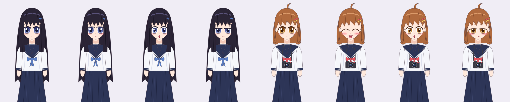

# 第七间教室 · The Seventh Classroom

一部用 [WebGAL](https://github.com/OpenWebGAL/WebGAL) 制作的网页 galgame。
类型是**校园恋爱**，**悬疑**为辅。

> 转学到青岚高中的你听说了一个传闻：旧校舍三楼明明只有六间教室，
> 可每到周五傍晚 6:07，走廊尽头会多出一间亮着灯的「第七间教室」……

- 剧情设定、角色、章节大纲和结局条件见 [docs/STORY.md](docs/STORY.md)
- 当前进度：**序章 + 第一章可玩**；角色立绘为矢量绘制的日系风格，背景为占位图



## 目录结构

```
game/                  游戏内容（WebGAL 的 game 目录）
  config.txt           游戏名、标题图等配置
  scene/               剧本：start.txt → prologue.txt → ch1.txt → ...
  background/          背景图
  figure/              角色立绘
  bgm/ vocal/          音乐 / 语音（待补）
docs/STORY.md          剧情设定文档
scripts/
  webgal.sh            拉取引擎、本地预览、打包
  check_scenes.py      剧本静态检查（标签、场景、素材引用）
  sprites/             角色立绘（矢量定义 + 导出 PNG）
  gen_placeholders.py  生成占位背景
art/sprites/           立绘 SVG 源文件
.github/workflows/     推送到 main 后自动部署到 GitHub Pages
```

引擎本身不放进仓库，`scripts/webgal.sh setup` 会把指定版本的 WebGAL 拉到 `engine/` 目录（已在 `.gitignore` 中忽略）。

## 本地运行

需要 Node.js 18+、Yarn 1.x、Python 3、Git。Windows 用户请在 Git Bash 里执行。

```bash
./scripts/webgal.sh setup   # 第一次：下载 WebGAL 引擎并安装依赖
./scripts/webgal.sh dev     # 本地预览 http://localhost:3000
./scripts/webgal.sh build   # 打包成静态网页
```

修改 `game/` 下的内容后，重新运行 `dev` 即可同步。

**另一种方式**：下载 [WebGAL Terre 可视化编辑器](https://github.com/OpenWebGAL/WebGAL_Terre/releases)，
新建游戏后，把本仓库 `game/` 目录里的内容复制进去，就能用图形界面编辑和预览。

## 在线部署（GitHub Pages）

1. 打开仓库的 **Settings → Pages**，把 **Source** 设为 **GitHub Actions**
2. 推送到 `main` 分支后会自动构建，完成后访问 `https://<你的用户名>.github.io/mygame/`

## 写剧本速查

```
:旁白文字;
苏晴:角色台词;
{me}:主角台词（me 是玩家输入的名字）;
changeBg:classroom.png -next;
changeFigure:suqing_smile.png -left -next;
changeFigure:none -left -next;
choose:选项一:label_a|选项二:label_b;
label:label_a;
setVar:aff_su=aff_su+1;
jumpLabel:somewhere -when=aff_su>2;
changeScene:ch2.txt;
```

注意：台词里的冒号和分号请用全角字符（`：` `；`），半角的会被当成语法。
完整语法见 [WebGAL 文档](https://docs.openwebgal.com/)。写完后运行 `python3 scripts/check_scenes.py` 检查。

## 美术

- **角色立绘**由 `scripts/sprites/characters.mjs` 用 SVG 矢量绘制（发型、配色、表情都是参数），
  修改后运行 `npm install && npm run sprites` 重新导出到 `game/figure/`。
- **背景**目前是 `scripts/gen_placeholders.py` 生成的占位图。
- 有正式美术（约稿 / AI 绘图）时，保持文件名不变，直接覆盖 `game/background/` 和 `game/figure/` 下的图片即可。
素材清单见 [docs/STORY.md](docs/STORY.md#美术素材清单)。

## 许可

剧本与原创素材归作者所有。WebGAL 引擎使用 [MPL-2.0](https://github.com/OpenWebGAL/WebGAL/blob/main/LICENSE) 许可。
